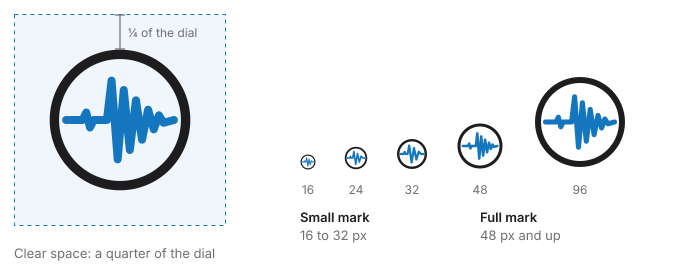
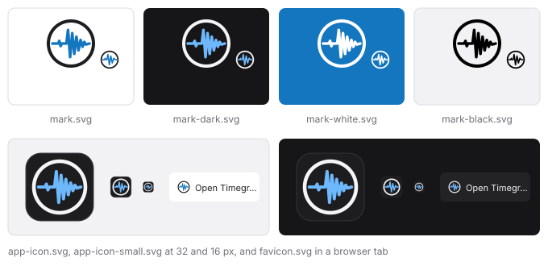
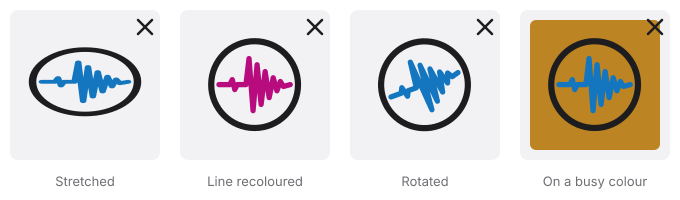
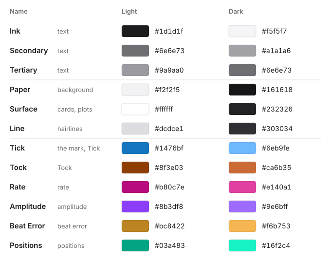
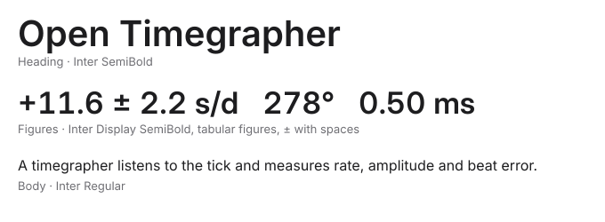
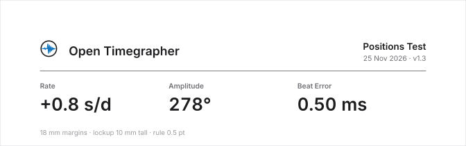

# Open Timegrapher identity guide

How Open Timegrapher looks when it isn't the app: the website, articles,
release notes, the PDF report, slides, stickers. The app's own screens follow
the [design guide](../docs/developer/design/design-guide.md); where the two
share something (colours, Inter), they agree, and the app's `palette.rs` is
the source.

## 1. The idea

Open Timegrapher is an instrument. It shows measured values and says what
they are. So does everything around it:

- **Plain and exact.** Flat colour, hairlines, real figures with units. No
  gradients, shadows, glows or textures.
- **Real things.** Real readings from real takes, real watches and real
  benches. No stock photos, and no figures made up for show.
- **One colour carries meaning.** Ink does the work. Colour marks a
  quantity, the same way it does in the app.

## 2. The mark

A dial with the sound of one tick inside it, drawn as the app's Scope
shows it: a small first burst, then the drop, ringing down.

- **The line is Tick blue,** the colour of Tick in the app. The dial is ink.
- **Two drawings.** The small mark (`mark-small*`, `lockup-small*`) has
  fewer swings and heavier lines, for a dial 16 to 32 px across. The full
  mark is for a dial 48 px and up. At 40 px, either works. Sizes here are
  the dial's: the `mark` and `lockup` files are larger than their dial
  because they carry their clear space (a `mark` file is 1.5 times its
  dial, so a 48 px dial is a 72 px file).
- **Clear space:** a quarter of the dial on every side, kept free of text
  and edges. The `mark` and `lockup` files have it built in, so they can
  sit right up against other things. The small mark, the favicon and the
  app icon don't, because the tab or the icon's plate is their edge.
- **Smallest size:** a dial of 16 px on screen, or 5 mm across in print.
  A `lockup` file is at least 72 px tall; below that, use
  `lockup-small`.

| Background | Use |
|---|---|
| White or light | `mark.svg`, `lockup.svg` (`lockup-small.svg` under 72 px tall) |
| Dark | `mark-dark.svg`, `lockup-dark.svg`, `lockup-small-dark.svg` |
| A photo, a colour, or one-colour print | `mark-black.svg` or `mark-white.svg`, whichever has more contrast |
| App icon | `app-icon.svg`; `app-icon-small.svg` at 16 and 32 px |
| Browser tab | `favicon.svg` |

### Don't

- Don't stretch, rotate, outline or add effects to it.
- Don't recolour the line, except in the one-colour versions.
- Don't put the colour mark on a colour or a busy photo; use a one-colour
  version, or put it on a plain light or dark ground.
- Don't redraw it or retype the name. Use the files.

## 3. The name

- **Open Timegrapher**: two words, capital O and T, everywhere a person
  reads it.
- Not "OpenTimegrapher", "Open TimeGrapher", "OTG" or "Open TG".
- `timegrapher` is the command and the crate names. Set it in code type
  when you mean the command.
- The website is **opentimegrapher.org**, in lower case.
- In running text, the name is plain text, not the logo.

## 4. Colour

- **Ink and paper** do most of the work: ink for text, line for hairlines,
  surface for cards and plots, paper behind them.
- **Tick blue is the brand colour.** It's the line in the mark, links on
  the website and the one accent on a page that has no data.
- **The six data colours mean their quantity, everywhere and only
  there** (design guide, section 7). A chart in an article uses Rate
  magenta for rate and nothing else.
- **Red is not a project colour.** In the app it means a failure, on an
  icon.
- Amber (Beat Error) and teal (Positions) are too light for text on white;
  use them for lines, dots and fills.
- Values are in [`tokens/`](tokens/) as CSS and JSON. If one ever differs
  from `crates/timegrapher-core/src/palette.rs`, the palette is right.

## 5. Type

- **Inter** for everything: SemiBold (600) for headings and figures,
  Regular (400) for text. Inter Display SemiBold for figures of 32 px and
  up, as in the app.
- **JetBrains Mono** only for commands, file names and code.
- **Ligatures:** Inter's standard ligatures stay on. Turn on tabular
  figures (`font-variant-numeric: tabular-nums`, OpenType `tnum`) wherever
  numbers line up. Turn off JetBrains Mono's code ligatures
  (`font-variant-ligatures: none`), so `->` and `!=` read as typed.
- **Numbers:** a true minus (−), a space before a unit ("10 s",
  "0.20 ms"), none before degrees ("278°"), and `+11.6 ± 2.2 s/d` with
  spaces round ±. Rates are in s/d. Significant figures follow the app: 1°,
  0.1 s/d, 0.01 ms.
- **Case:** Title Case for titles and labels, sentence case for sentences.
- Both fonts are under the SIL Open Font License. Use no font without that
  licence or one as free, so everything can ship in the app and be
  embedded in a PDF.

| Use | Screen | Print |
|---|---|---|
| Page title | Inter SemiBold 28 to 42 px | 18 pt |
| Section heading | Inter SemiBold 20 to 24 px | 12 pt |
| Text | Inter 16 to 17 px, line height 1.6 | 10 pt on 14 pt |
| Big figure | Inter Display SemiBold 32 px, tabular | 24 pt |
| Caption, label | Inter 13 px, secondary ink | 8 pt |

## 6. Layout and spacing

- **Spacing steps:** 4, 8, 12, 16, 24, 32, 48 and 64 px. The app uses the
  first five; pages and print use the rest for sections.
- **Corners:** 6 px on controls, 10 px on cards. Pictures and the app icon
  plate are the only other rounded things.
- **The logo in a box** (a badge, a sticker, a card): the box's edge
  sits at the logo's clear space, and its corners take the card radius,
  10 px when the dial is 48 px across, scaled with the logo. The thin
  frames round the pictures in this guide are only how the page shows
  them, not part of the logo.
- **Lines:** 1 px hairlines in the line colour; one ink rule of 0.5 pt
  under a print header.
- **Width:** text no wider than about 70 characters.
- **Left-aligned,** with the picture or the figure first. Centre only a
  single mark or a single figure.
- **Light by default,** with a dark version wherever a screen can show one.

## 7. Print and PDF reports

The PDF report (#1866) uses these rules by default.

- **Paper:** A4 or US Letter, as the reader's region uses; margins 18 mm.
- **Header:** the lockup 10 mm tall at the top left; the report's title
  and its date and app version at the top right; a 0.5 pt ink rule under
  both.
- **Colour:** the light colours. Data keeps its colour on a chart. On a
  one-colour printer, the mark is `mark-black.svg` and charts tell series
  apart by line style and label, as the app does for grey call-outs.
- **Figures:** Inter SemiBold, tabular, with ± and units as in the app.
- **Fonts are embedded** (both are OFL), so a report looks the same
  everywhere.
- **Facts only.** A report states what was measured, as the app does: no
  grades, verdicts or advice in the software's voice.
- **Footer:** page *n* of *m*, the take's name, and "Open Timegrapher" with
  the app's version.

## 8. Using the assets

Everything here is free to use under CC BY 4.0 (see [README.md](README.md)).
The name and logo follow [POLICY.md](POLICY.md): use them to refer to
Open Timegrapher; a fork or a modified build uses its own.
