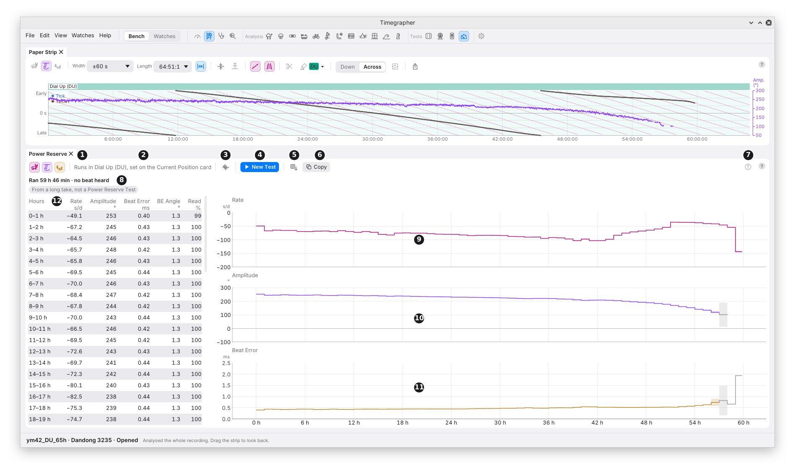
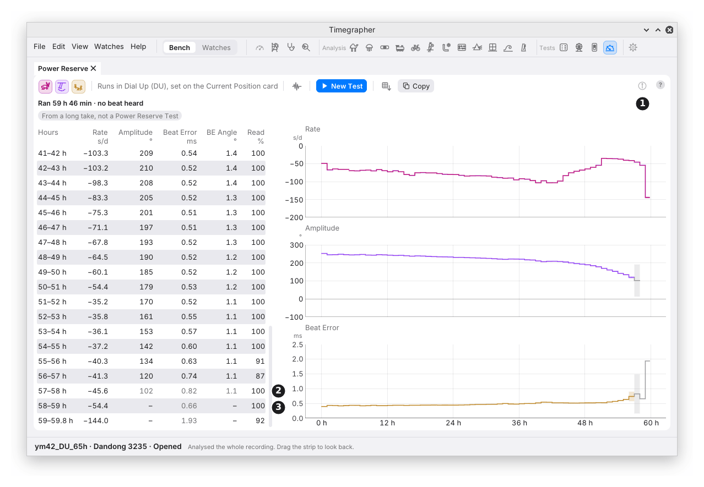

# 21. Power Reserve Test

**What it shows:** how long the watch runs from full wind until it stops,
in one position, and how its rate, amplitude and beat error change hour
by hour on the way.

**Why you'd use it:** the power reserve is how long a full wind lasts.
A watch that stops well short of its calibre's figure, or whose amplitude
falls away early, can point to the mainspring, its lubrication or the
barrel. The hour table also shows how the rate moves as the mainspring
lets down, the same thing Isochronism (chapter 19) reads by amplitude.

The Power Reserve pane is a hidden tab beside the Positions Test, its
icon a fuel gauge near empty, under **Tests** in the icon bar and the
View menu.

## The Toolbar

| Mark | Control | What it does | Why you'd use it |
| --- | --- | --- | --- |
| 1 | **Series** (three icons) | Turns each chart on or off: Rate, Amplitude, Beat Error. The charts left on share the room; with all three off, the table stands alone. | To give one chart the whole height, or the table the whole pane. |
| 2 | The position | "Runs in Dial Up (DU), set on the Current Position card". The test runs in the position on that card; the pane has no position setting of its own. | Set the position on the card before you start. |
| 3 | **Keep Sound** or **Analysis Only** | Keep Sound keeps the run's sound in the take. Analysis Only keeps its analysis alone and never writes the sound, as if Keep Analysis Only had been used (chapter 23). | A run of 40 hours or more is a large file. The pane's hover before a test gives the space free against the most an 80-hour run writes: 0.35 GB (gigabytes) an hour at 48 kHz, 16-bit. |
| 4 | **New Test** | Sets the test up on a clear Bench and starts nothing. **Cancel Test** then takes its place. | To start a run. |
| 5 | **Save as CSV…** | Saves the watch, the run and the hour table, with a "Beat error from" column and a "BE Angle (deg)" column. | For a spreadsheet or a service record. |
| 6 | **Copy** | The same, on the clipboard, with tabs between the columns. | To paste into a note or a message. |
| 7 | **i** (Info) | Opens the Info panel: the run in full ("No beat heard since 17 Nov 22:42" when it ended that way), where the take is kept, the beats' pauses, and what grey means in the table. | For the whole story behind the title's short form. |

## Running a Test

1. Wind the watch fully and set its position on the Current Position
   card.
2. **New Test**, then **Start Test** on the Listen card. A new session
   starts in that position.
3. Leave it. While the test runs, the computer is kept awake, whatever
   Keep Awake is set to, and the position can't change. The pane shows
   the run time from the first beat heard, how the beats stand, and the
   stops on the way, with the hours so far.
4. The test ends by itself when the watch stops. **Stop Test…** on the
   Listen card ends it early, after asking, with **Keep Measuring** the
   default.

**When no beat is heard:** the run ends at the last beat heard
before 10 minutes with none. A stopped watch and a pickup that slipped
sound the same, so the pane says only what it heard: "No beat heard
since 17 Nov 22:42", the last beat's time in this computer's time
zone. A beat counts when it matches the watch's
sound with a quality over 0.4, in a run of at least eight such beats each
within one and a half beats of the last, so a lone click is not the
watch. Beats that come back sooner join the run, and each silence of 30 s
or more inside it is counted as a stop on the way. A run still going at
80 hours ends there.

The take is kept in the watch's history, named by its local start time
and "Power Reserve". The Watches view lists it as "Power Reserve 46 h
12 min", adding how it ended when the watch didn't stop it: "Stopped by
hand while the watch still ran", or "Reached the 80 h limit while the
watch still ran". If the recording itself fails, for example on a full
disk, the run ends there and reads "at least": "Power Reserve at least
2 h 01 min · The recording failed while the watch still ran". Its hours
so far are kept in the take, and the take keeps its sound even with
Analysis Only picked.

With Analysis Only, the analysis is kept on the disk every 10 minutes as
the test runs. If the app stops before the test ends (a crash or a power
cut), the next start offers the run back: "An unsaved Power Reserve Test
was found (Analysis Only)". **Open** reads it up to the last 10 minutes
kept, and the run reads "at least", since the watch may have run on
after that, unless the watch's stop was already heard by then. The
notice says how much was recorded; the run, from the first beat heard
to the last, is no longer. **Move To…** puts it in a folder of your
own.

## The Results

| Mark | Part | What it shows |
| --- | --- | --- |
| 8 | The title | The run time in true time (through the sound card's measured clock) and how it ended, in short: "Ran 41 h 12 min · no beat heard". When the beats stopped and came back on the way, it adds how many times: "· restarted 2 times". The position is in the toolbar, and the run in full in the Info panel (mark 7). |
| 9 | The rate | The rate against hours since the first beat: a step for each hour, an ended run's last part hour included, with a shaded band for the hour's ± where it has one. Hover a step for its figure. |
| 10 | The amplitude | The amplitude against the same hours. |
| 11 | The beat error | The beat error (ms) against the same hours. A figure grey in the table (below) is a grey step in its chart. |
| 12 | The hour table | Each hour: its rate (s/d), median amplitude (°), beat error (ms) from the unlock, its BE Angle (°), and how much of the hour its whole 10 s readings cover (Read %). The last hour is as long as is left. |

**BE Angle** is the hour's beat error as an angle of the balance's
swing: amplitude × π × beat rate / 7200 × beat error. The beat error in
ms grows as the amplitude falls, even when nothing in the escapement has
moved, because the balance passes its centre more slowly; the angle
stays the same. In the picture the beat error grows from 0.40 ms in the
first hour to 0.74 ms in the 56–57 h hour while the BE Angle falls only
from 1.3° to 1.1°: the escapement did not move. The angle rests on the
lift angle through the amplitude, so a lift angle 7% off makes it 7%
off; the ms does not. It is grey where its beat error or amplitude is,
and a dash where there is no amplitude. [M5](m5-beat-error.md) says
more.

Grey in the table marks a figure that stands on less than the rest, and
the Info panel says what each kind of grey means. A beat error from the drop, where the
unlock isn't found or its windows disagree in sign beyond their spread
(M5), or whose source wasn't recorded, is grey, and its hover names its
source. An amplitude or beat error read from under 60%
of the hour's 2 s windows is grey too, and its hover says how many
("read from 459 of 1798 windows"). An amplitude read from under a tenth of them isn't given
at all: the cell shows a dash, and the amplitude chart stops before that
hour. A figure grey in the table is a grey step in its chart too. A few windows are too few to stand for an hour; the figure they
give can be far from the truth.
Scrolled down, the table's titles stay at the top.

While a test runs, about once a minute the hour in progress is measured
again, and it shows as a finished run's last would: a part hour labelled
"2–2.4 h", its hover giving the exact time, "A part hour: 26:28 past
2 h". The
charts start from the first whole hour.

## From a Long Take

A take that isn't a Power Reserve Test, in one position, with six hours
or more from its first beat to its last, fills the pane the same way, as
in the picture: one opened whole, or a Quick Listen still listening,
whose run so far is read again once a minute and says "Still listening,
no stop found yet" until listening stops. Its wind at the start
isn't known, so its run is never called a power reserve: a grey chip
under the title reads "From a long take, not a Power Reserve Test", and
the title reads "Ran at least …" when the watch was still running at the
take's end. The Info panel says it in full: "Ran 59 h 46 min in … from
the take's start". Nothing is written into the take.

**In the picture** is a Dandong 3235, fully wound, left dial up on the
stand and recorded until it stopped: "Ran 59 h 46 min · no beat heard". The
Paper Strip above it shows the whole
take, the amplitude line falling to the right and the beats ending
before the take does. Hour by hour, the amplitude falls from 253° in
the first hour to about 210° at 42 hours, then faster, to 120° in the
56–57 h hour: the steady fall and the late drop of a mainspring letting
down. The amplitude chart ends with a grey step, 102° in the 57–58 h
hour, and stops there; the table's last hours, below, say why. The rate is −49 s/d in the first hour, near −65 s/d from
then to 12 hours, about −100 s/d at 42 hours, then climbs to about
−40 s/d from 52 to 57 hours, and falls to −144 s/d in the last part
hour. So this watch's rate moves by about 70 s/d over its reserve: what it
keeps on the wrist depends on how far down it is allowed to run.

| Mark | Part | What it shows |
| --- | --- | --- |
| 1 | **i** (Info) | The Info panel says what grey means in each column. |
| 2 | A grey amplitude and beat error | Read from under 60% of the hour's windows, or a beat error from the drop; the hover gives the count or the reason. The BE Angle beside them is grey too. |
| 3 | A dash | An amplitude withheld: under a tenth of the hour's windows gave one. The beat error beside it is grey, and the BE Angle is a dash. |

**Scrolled to its end,** the same table shows the watch's last hours.
The amplitude falls from 179° in the 50–51 h hour to 120° in the 56–57 h
hour, and the beat error rises from 0.53 to 0.74 ms, while the BE Angle
moves only from 1.2° to 1.1°. From 57 hours the beats grow faint, and the unlock that
the amplitude is timed from is found in fewer of the hour's windows: in
the 57–58 h hour the amplitude, 102°, and the beat error, 0.82 ms, are
grey, and their hovers say why. In the last two hours the unlock is
found in too few windows to give an amplitude, and the cells show a
dash; the beat errors there, 0.66 and 1.93 ms, are grey. The rate,
timed from the whole beat, is still read: −54.4 s/d, then −144.0 s/d in
the last part hour as the watch stops.

## What to Look For

| What you see | What it can mean |
| --- | --- |
| A run well short of the calibre's power reserve | The mainspring, its lubrication, the barrel, or a wind that wasn't full. |
| The amplitude falling steadily, then faster near the end | The mainspring letting down; the last hours have the least power. |
| The rate moving as the amplitude falls | The watch's isochronism (chapter 19). |
| Stops on the way | Silences of 30 s or more: the watch stopping and starting, or the sound lost. |
| A low Read % in an hour | Little of that hour could be read: noise, or a weak sound late in the run. |

## What It Can't Tell You

- **The cause** of a short reserve. The run time and the amplitude say how
  it ran down, not why.
- **The calibre's rated reserve.** Compare with the maker's figure; the
  app gives what this watch did.
- **Other positions.** A test runs in one position. A Positions Test
  (chapter 20) compares positions.
- **A wind it didn't see.** A run from a long take starts wherever the
  take started, not at full wind.

---

Previous: [Complication Test](20c-complication-test.md) ·
Next: [The Watches View](22-watches-view.md)
